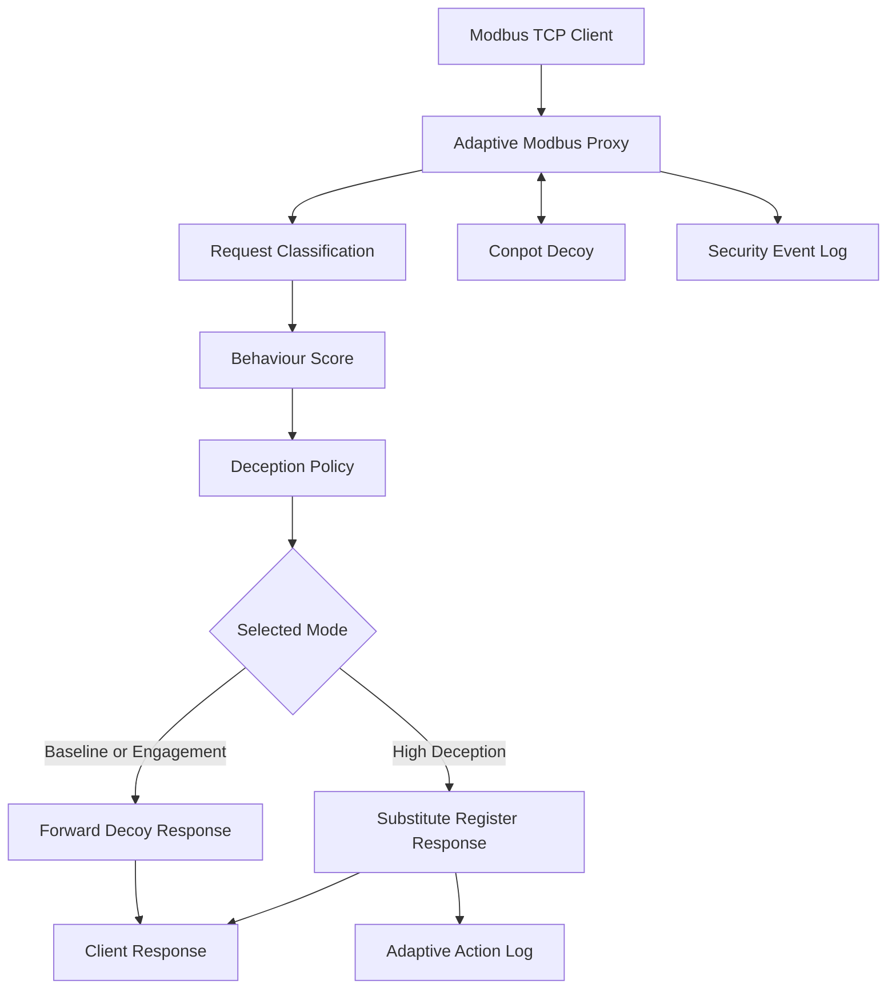

# Adaptive Deception-Based Honeynet for IIoT and SCADA

## Overview

This project explores an adaptive deception framework for Industrial Internet of Things (IIoT) and Supervisory Control and Data Acquisition (SCADA) environments.

The objective is to analyse interactions with simulated industrial assets, classify observed behaviour, and select deception strategies based on activity patterns.

## Current Implementation

- **Structured event logging:** Records timestamps, source IP addresses, asset identifiers, protocols, event types, severity, and metadata.
- **Persistent event storage:** Stores security events in JSON Lines format.
- **Behaviour-based detection:** Assigns weighted scores to observed event types.
- **Attacker classification:** Categorises activity based on accumulated behaviour scores.
- **Deception-mode selection:** Selects a baseline, engagement, or high-deception mode according to the classification.
- **Event analysis:** Processes stored events and summarises observed activity by source IP.

The current prototype is tested using synthetic events.

## Planned Development

- Integration with the Conpot industrial honeypot.
- Simulated PLC and HMI services.
- Adaptive deception policies that change decoy behaviour or presented information.
- A monitoring dashboard for event analysis.
- Controlled experiments comparing static and adaptive deception.
- Evaluation using measurable engagement and intelligence-collection metrics.

## Technology Stack

- Python
- Git and GitHub
- Conpot — planned integration
- Docker — planned deployment

## Research Question

Can behaviour-driven adaptive deception improve attacker engagement and intelligence collection in a simulated IIoT/SCADA environment compared with a static honeypot?

## Project Status

**Early prototype.** Structured event logging, persistent storage, rule-based behaviour scoring, and initial deception-mode selection have been implemented. Live industrial honeypot telemetry, operational adaptive decoys, and experimental evaluation remain future work.

## Safety

This project is intended for an isolated, authorised cybersecurity laboratory. Decoy services should not be exposed to public or production networks without appropriate security controls.

## Disclaimer

This is an educational cybersecurity research project. Performance claims will be based on documented experiments rather than assumed results.

## System Architecture

The prototype uses a Modbus TCP proxy between the client and the Conpot industrial decoy. Requests are scored as they pass through the proxy. The resulting score determines whether traffic receives the normal decoy response or an adapted response.

### Main Components

- **Adaptive Modbus Proxy:** Receives client requests, forwards them to Conpot, and can modify selected responses.
- **Request Classification and Behaviour Score:** Assigns points according to observed Modbus function codes and accumulates the score by source IP.
- **Deception Policy:** Selects a response mode based on the cumulative score.
- **Conpot Decoy:** Provides the underlying simulated industrial service.
- **Security Event and Adaptive Action Logs:** Record observed requests and changes made by the proxy.
